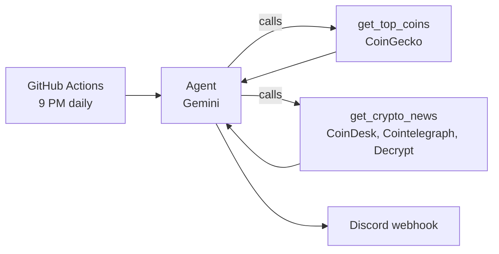

# Crypto News Agent

An AI agent that reads the day's crypto news, checks live prices, picks the 10 stories that matter most, and posts a short briefing to Discord every night at 9 PM.

Built with **LangChain**, **Google Gemini** and **GitHub Actions**.

## Example output

> 📈 **Crypto Briefing: Saturday, 14 November 2026**
>
> BTC: $67,197 (-2.98%), ETH: $1,906.81 (-2.49%), biggest top-10 mover: HYPE (-6.42%).
>
> 1. **Bitcoin ETF Outflows**: US spot Bitcoin ETFs shed $2.35B over two weeks. (Cointelegraph)
> 2. **JPMorgan Holdings**: The bank's crypto-linked holdings are nearing $1B. (Decrypt)
> 3. ...
>
> Not financial advice.

## How it works



1. The agent calls two tools: one for live prices (CoinGecko) and one for the latest headlines (RSS feeds).
2. Gemini picks the 10 most important stories, removes duplicates and writes a briefing of under 1,800 characters.
3. The briefing is posted to a Discord channel. If a run fails, a warning is posted instead.

## Quick start

**You need:** Python 3.10+, a free [Gemini API key](https://aistudio.google.com) and a [Discord webhook URL](https://support.discord.com/hc/en-us/articles/228383668) (Server Settings → Integrations → Webhooks).

```bash
git clone https://github.com/adityaamalik/crypto-news-agent.git
cd crypto-news-agent
python3 -m venv .venv
source .venv/bin/activate        # Windows: .venv\Scripts\activate
pip install -r requirements.txt
```

Create a `.env` file in the project folder:

```
GOOGLE_API_KEY=your-gemini-api-key
GEMINI_MODEL=gemini-3.5-flash-lite
DISCORD_WEBHOOK_URL=https://discord.com/api/webhooks/...
TIMEZONE=Asia/Kolkata
```

Run it:

```bash
python main.py --dry-run    # print the briefing without sending it
python main.py              # send it to Discord
python main.py --steps      # show every step the agent takes
```

## Run it every night (GitHub Actions)

The workflow in `.github/workflows/nightly-briefing.yml` runs the agent at 9 PM on GitHub's servers, so your computer doesn't need to be on.

1. Push the repo to GitHub.
2. Add your secrets and settings:
   ```bash
   gh secret set GOOGLE_API_KEY
   gh secret set DISCORD_WEBHOOK_URL
   gh variable set GEMINI_MODEL --body "gemini-3.5-flash-lite"
   gh variable set TIMEZONE --body "Asia/Kolkata"
   ```
3. Set your time zone in the workflow file (`timezone:` line).
4. Test it now: `gh workflow run nightly-briefing.yml`, then `gh run watch`.

## Configuration

| Variable | Required | Description |
|---|---|---|
| `GOOGLE_API_KEY` | Yes | Gemini API key |
| `DISCORD_WEBHOOK_URL` | Yes | Webhook for the target channel |
| `GEMINI_MODEL` | No | Model name (default `gemini-3.5-flash-lite`) |
| `TIMEZONE` | No | IANA time zone used for the date in the briefing |

To change what the briefing covers or how it's written, edit `SYSTEM_PROMPT` in `main.py`. To add news sources, add RSS feeds to `NEWS_FEEDS` in `tools.py`.

## Project structure

```
├── main.py                 # agent setup, prompt and entry point
├── tools.py                # tools: crypto news (RSS) and prices (CoinGecko)
├── notifier.py             # sends messages to Discord
├── requirements.txt
└── .github/workflows/
    └── nightly-briefing.yml
```

## Notes

- Gemini, CoinGecko and the RSS feeds are all used on free tiers. If a model is overloaded, change `GEMINI_MODEL`.
- Never commit your `.env` file. It is listed in `.gitignore`.
- This project is for learning and information only. **It is not financial advice.**